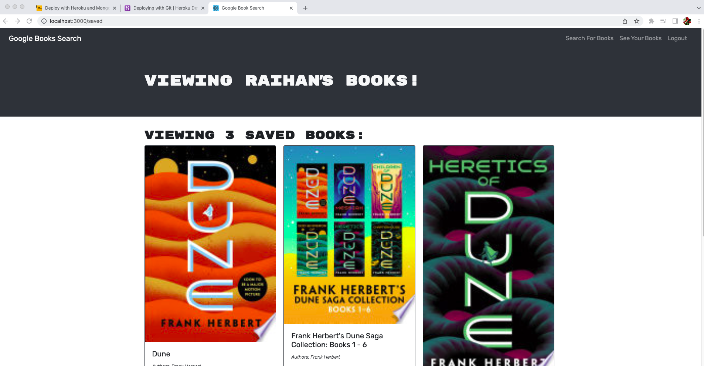

# Book Search — Google Books Reading List

[](https://github.com/mnoorzai21/book-searchjet-mnn/actions/workflows/ci.yml)

A full-stack MERN app for searching the Google Books catalog and keeping a personal reading list. Users sign up, search for any title, author or topic, save books to their account, and remove them later.

**Live demo:** https://book-searchjet.onrender.com (free hosting: the first load after a break can take about a minute)



## Features

- Search millions of books through the Google Books API, via a cached server-side GraphQL query
- Sign up and log in with JWT authentication and bcrypt-hashed passwords
- Save books to your account and manage your list on the **My Books** page
- GraphQL API built with Apollo Server, with clear errors for duplicate accounts and wrong passwords
- Responsive Bootstrap layout

## Technology Stack

**Frontend:** React 19, Vite, Apollo Client, React Router, React Bootstrap
**Backend:** Node.js, Express 5, Apollo Server 5 (GraphQL), Mongoose 8
**Database:** MongoDB (MongoDB Atlas in production)
**Testing and CI:** Node's test runner, mongodb-memory-server, GitHub Actions
**Hosting:** Render (free plan) and MongoDB Atlas (free M0 cluster)

## How It Works

```
React (Vite) ──GraphQL──▶ Express + Apollo Server ──▶ MongoDB Atlas
                                    │
                                    └──▶ Google Books API (cached searches)
```

Book searches go through the server, which keeps the Google API key private and caches results for 10 minutes.

In production, one Express server serves both the GraphQL API at `/graphql` and the built React app, so the whole project runs as a single free web service.

## Getting Started

### Prerequisites

- Node.js 20.12 or newer
- MongoDB running locally, or a free [MongoDB Atlas](https://www.mongodb.com/atlas) cluster

### Install

```bash
git clone https://github.com/mnoorzai21/book-searchjet-mnn.git
cd book-searchjet-mnn
npm run install:all
```

### Configure

```bash
cp server/.env.example server/.env
```

Set `MONGODB_URI` (local MongoDB or your Atlas connection string) and `JWT_SECRET` (any long random string). Optionally set `GOOGLE_BOOKS_API_KEY` (see below).

### Run

In two terminals:

```bash
npm run dev:server   # API on http://localhost:3001/graphql
npm run dev:client   # app on http://localhost:3000
```

### Test

```bash
npm test
```

The tests start a real in-memory MongoDB and cover sign-up, login, duplicate accounts, saving and removing books, authentication and serving the React app.

## Deploying for Free

1. **Database:** create a free **M0** cluster on MongoDB Atlas, add a database user, allow network access from `0.0.0.0/0`, and copy the connection string.
2. **App:** on [Render](https://render.com), choose **New > Blueprint**, select this repository, and paste the connection string as `MONGODB_URI`. The included `render.yaml` sets up everything else, including a generated `JWT_SECRET`.

3. **Search (recommended):** create a free Google Books API key (Google Cloud Console > APIs & Services > enable **Books API** > Credentials > **Create API key**) and add it in Render as `GOOGLE_BOOKS_API_KEY`. Without a key, searches share Google's anonymous limit and may fail with a "busy" message.

Render's free plan sleeps after 15 minutes without traffic, so the first visit after a break can take about a minute to load.

## Author

**Mohammad Nabi Noorzai**

- GitHub: [mnoorzai21](https://github.com/mnoorzai21)
- LinkedIn: [mnoorzai21](https://www.linkedin.com/in/mnoorzai21)
- Email: [mnoorzai21@gmail.com](mailto:mnoorzai21@gmail.com)
